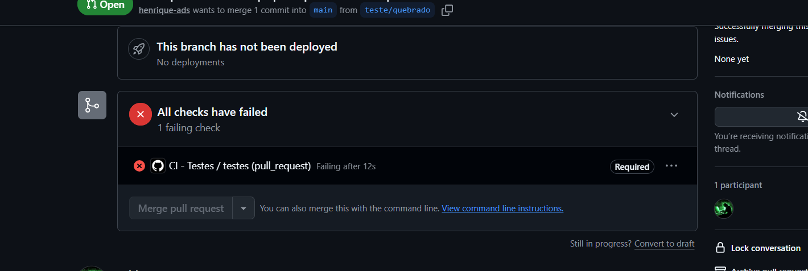
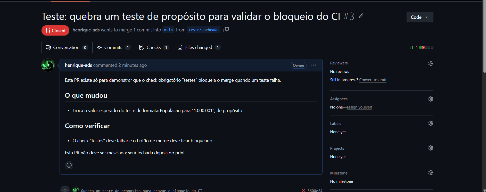

# ✈ TERMINAL INTL

Explorador de países com visual de painel de partidas de aeroporto. Cada país vira um "voo": código do país como portão de embarque, capital, região e população como número de passageiros. Você pode "embarcar" um país para uma lista pessoal de destinos, salva em banco de dados real.

Este repositório é o **desafio final do Bootcamp II (Etapa 03)**: além da aplicação, ele demonstra um fluxo de trabalho profissional, com a `main` protegida, todo código entrando por Pull Request e testes automatizados rodando no GitHub Actions.

- **Repositório GitHub:** https://github.com/henrique-ads/Explorador-de-pa-ses-
- **Aplicação (GitHub Pages):** https://henrique-ads.github.io/Explorador-de-pa-ses-/
- **Imagem no Docker Hub:** https://hub.docker.com/r/henriqueads/bootcamp2-app

## 1. Integrantes

O projeto foi desenvolvido **individualmente**, por isso a tabela tem uma única linha. O professor foi informado de que o grupo é de uma pessoa.

| Nome | Matrícula | Usuário GitHub | Funcionalidade pela qual respondeu | Principal PR |
| --- | --- | --- | --- | --- |
| Henrique Bernardes Machado | «22603659» | [henrique-ads](https://github.com/henrique-ads) | Todas: interface, persistência (Supabase), consumo de APIs, testes, CI e Docker | [PR #2 · Busca sem acento](https://github.com/henrique-ads/Explorador-de-pa-ses-/pull/2) |

## 2. Sobre a aplicação

### Descrição

O painel carrega todos os países e permite buscar por nome (em português ou inglês, **com ou sem acento**) e filtrar por região. Cada país aparece como um cartão de voo com bandeira, capital, região e população. Clicar em "★ EMBARCAR" salva o país na seção **MEUS DESTINOS**, onde é possível marcá-lo como `visitado` ou `desejado` e excluí-lo.

### APIs externas consumidas

A REST Countries API (`restcountries.com`) foi descontinuada e a nova versão exige cadastro e chave, então a aplicação usa fontes públicas e sem chave:

- [World Bank API](https://data.worldbank.org): população mais recente de cada país (consumida via `fetch` a cada carregamento da página).
- [`mledoze/countries`](https://github.com/mledoze/countries): dataset estático (JSON) com nome (inclusive tradução em português), capital, região, moedas e idiomas, servido via CDN (jsDelivr).
- [flagcdn.com](https://flagcdn.com): imagens das bandeiras por código do país.

### Banco de dados

**Supabase (PostgreSQL)**, plano gratuito, com a tabela `favoritos`:

| Coluna | Tipo | Descrição |
| --- | --- | --- |
| `id` | uuid / bigint (PK) | Identificador do registro |
| `criado_em` | timestamp (default now) | Data/hora em que o país foi salvo |
| `nome_item` | text | Nome do país (em português) |
| `dados_extra` | jsonb | `{ cca3, capital, region, flagUrl, status }`, com `status` igual a `"desejado"` ou `"visitado"` |

A aplicação faz o CRUD completo: **criar** (embarcar), **listar** (meus destinos), **atualizar** (alternar `desejado`/`visitado`) e **excluir**.

As políticas de acesso (RLS) da tabela estão abertas para o papel `anon`, o que é aceitável apenas neste contexto de estudo. Em produção real, cada usuário deveria autenticar e acessar só os próprios registros.

## 3. Como executar

### Com Docker (recomendado)

```bash
docker run -d -p 8080:80 henriqueads/bootcamp2-app:latest
```

Abra http://localhost:8080. Não é necessária nenhuma variável de ambiente: a URL e a chave **pública** (`anon`/publishable) do Supabase ficam no `script.js`, como é padrão em aplicações front-end. A imagem está em https://hub.docker.com/r/henriqueads/bootcamp2-app.

### Localmente, sem Docker (Windows)

```powershell
powershell -ExecutionPolicy Bypass -File serve.ps1
```

Abra http://localhost:8938.

## 4. Testes

Os testes usam o [Jest](https://jestjs.io/) e cobrem as funções puras do `utils.js`:

| Função | O que faz |
| --- | --- |
| `validarBusca` | Aceita buscas com pelo menos 2 letras (ignora espaços nas pontas) |
| `formatarPopulacao` | Formata números no padrão brasileiro (`1.000.000`) e devolve `-` para valores inválidos |
| `formatarNome` | Coloca a inicial em maiúscula (utilitário testado) |
| `normalizarTexto` | Deixa o texto em minúsculas, sem acento e sem espaços nas pontas (usada na busca) |

Para rodar (requer Node.js 20 ou superior):

```bash
npm install
npm test
```

São **8 testes** automatizados. No GitHub, eles rodam a cada Pull Request e a cada push na `main`, pelo workflow `.github/workflows/ci.yml` (job `testes`).

## 5. Fluxo de trabalho e evidências

### Proteção da `main`

Um *ruleset* (Settings → Rules) protege a `main` com:

- **Require a pull request before merging:** nenhum código entra direto na `main`.
- **Require status checks to pass:** o check obrigatório `testes` (GitHub Actions) precisa estar verde para liberar o merge.

Como o projeto é individual, o número de aprovações exigidas é **0**: o GitHub não permite que o autor aprove a própria PR. A revisão foi feita por mim mesmo, relendo o diff e registrando comentários na aba *Files changed* de cada PR.

### Pull Requests do projeto

| PR | Título | Resultado |
| --- | --- | --- |
| [#1](https://github.com/henrique-ads/Explorador-de-pa-ses-/pull/1) | Usa validação de busca e formatação de população do utils | Mesclada |
| [#2](https://github.com/henrique-ads/Explorador-de-pa-ses-/pull/2) | Adiciona busca sem acento com normalizarTexto | Mesclada |
| [#3](https://github.com/henrique-ads/Explorador-de-pa-ses-/pull/3) | Teste: quebra um teste de propósito para validar o bloqueio do CI | Fechada sem mesclar (evidência) |
| [#4](https://github.com/henrique-ads/Explorador-de-pa-ses-/pull/4) | Inclui utils.js na imagem Docker | Mesclada |
| [#5](https://github.com/henrique-ads/Explorador-de-pa-ses-/pull/5) | Documentação final da Etapa 03 | Mesclada |

A PR #4 corrigiu um defeito real: o `Dockerfile` não copiava o `utils.js`, então a imagem publicada no Docker Hub não tinha as funções usadas pela busca. Depois da correção, a imagem foi reconstruída e publicada.

O workflow e os testes iniciais (commit `Adiciona testes e CI`) entraram direto na `main`, **antes** de ativar a proteção, porque o check `testes` precisa ter rodado uma vez para poder ser marcado como obrigatório.

### Evidência: PR bloqueada pelo CI

A [PR #3](https://github.com/henrique-ads/Explorador-de-pa-ses-/pull/3) alterou um teste de propósito (o valor esperado de `formatarPopulacao` passou para `"1.000.001"`). O check obrigatório `testes` falhou e o botão **Merge pull request** ficou bloqueado, como mostra o primeiro print. Depois, a PR foi **fechada sem mesclar**, como mostra o segundo.





### Conflito de merge

Não houve conflito de merge neste projeto: as PRs foram feitas em sequência, por uma única pessoa, e cada uma partiu da `main` atualizada.

## Sidequests da Etapa 02

- **SQ1 · .dockerignore:** exclui `.git`, `README.md`, `serve.ps1` e arquivos de editor da imagem, deixando o build mais rápido e a imagem menor.
- **SQ2 · Versionamento de imagem:** publicadas as tags `1.0`, `1.1` e `latest` no Docker Hub.
- **SQ3 · Descrição no Docker Hub:** overview com o que é a aplicação, o comando `docker run` e o link deste repositório.
- **SQ4 · Orquestração:** print em `evidencias/docker-ps-dois-containers.png` com dois containers rodando (portas 8080 e 8081).

  **Se eu tivesse 100 containers, como gerenciaria?** Rodar e monitorar 100 containers com `docker run`/`docker ps` não escalaria; seria preciso orquestração. O **Kubernetes** agrupa containers em **pods** (a menor unidade que ele gerencia), mantém **réplicas** de um mesmo serviço (o ReplicaSet garante que sempre haja N cópias saudáveis rodando, reiniciando as que falham) e distribui tudo entre várias máquinas, os **nós**, que juntas formam um **cluster**. Escalar de 1 para 100 containers vira uma questão de mudar o número de réplicas, e o cluster cuida de onde rodar cada um, substituir os que caem e balancear a carga.

## Publicando no GitHub Pages

1. **Settings → Pages → Source**: branch `main`, pasta `/ (root)`.
2. Site disponível em `https://<usuario>.github.io/<repo>/`.

## Stack

HTML/CSS/JS puro (sem build step), Supabase para persistência, Jest e GitHub Actions para testes e integração contínua, Nginx + Docker para empacotamento e distribuição.
